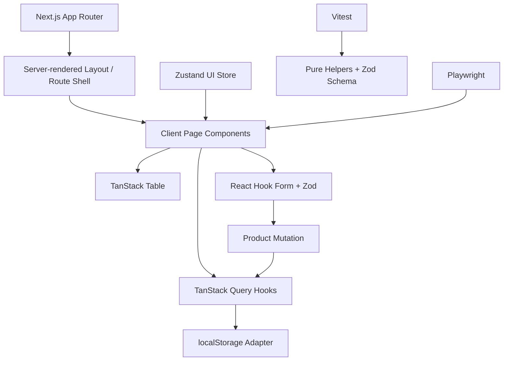
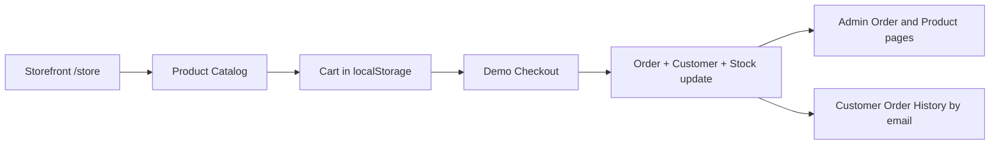

# Architecture Notes

## Important trade-offs

- `localStorage` makes the demo easy to run, but is not multi-user or trusted persistence.
- The app shell is server-rendered by Next.js; interactive pages are client components for TanStack Query and browser storage.
- When connected to an API, move authorization, business invariants, and durable validation to the server. Use database pagination for large tables.
- The chart intentionally labels sample data as illustrative; it must not be presented as actual analytics.

## Customer storefront flow

Storefront and admin reuse the same browser-local storage adapter. This demonstrates an integrated user flow but is intentionally not secure or multi-user. A real application should use authenticated APIs, database transactions, and server-side stock validation.
